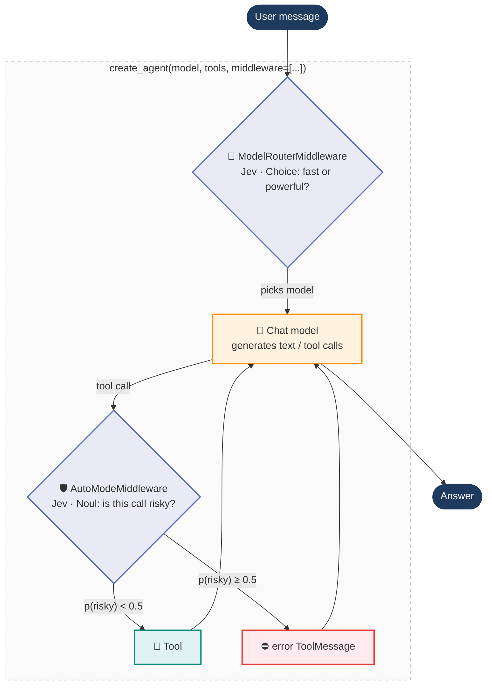

# System One Models, with Jev and LangChain

**A lesson on the newest kind of model in your toolbox — one that never generates text.**

Every agent makes dozens of small decisions that are not "write me a paragraph": *which model
should handle this? is this ticket urgent? should this tool call run? which of these four labels
is it?* Today most teams answer those questions with another LLM call — slow, expensive, and
prone to returning a paragraph when you wanted a boolean.

**Jev** is [TypeSafe AI](https://typesafe.ai)'s answer: the first of what they call **System One
models**. You give it *state* (text, JSON, or LangChain messages) and a set of typed *questions*;
it returns typed, calibrated answers — a probability, a chosen label, or a score — in a single
parallel pass, in tens to hundreds of milliseconds. It cannot produce free-form text, so it
cannot hallucinate an output that doesn't fit the schema you asked for.

> **Agent = Model + Harness.** Jev is not the model that does the work. It is the model that
> makes the harness's decisions.

LangChain exposes Jev through [`langchain-typesafe`](https://pypi.org/project/langchain-typesafe/):
a `TypeSafeClassifier` Runnable plus two experimental agent middlewares. This branch walks from
a single yes/no question to Jev routing models and gating tool calls inside `create_agent`.

## The Big Idea



The chat model still does the generating. Jev sits at the two decision points every harness
has — *which model runs* and *whether a tool call is allowed* — and answers them in milliseconds
for a fraction of a cent, with a confidence number your code can gate on.

### What "System One" means

The name is borrowed from Kahneman: System One is fast, intuitive judgment; System Two is slow,
deliberate reasoning. Autoregressive LLMs are System Two machines — every token conditions on the
last, which is exactly right for writing and exactly wrong for "pick one of four labels".
Jev drops autoregression entirely. TypeSafe trains it with what they call **RLCD**
(reinforcement learning for calibrated decisions), optimizing not for human preference but for
*honest probabilities*: when Jev says 0.9, it should be right about 90% of the time.

### The three primitives

| Primitive | Question shape | You get back |
| --------- | -------------- | ------------ |
| `Noul`    | yes / no                          | `noul` — probability the answer is yes |
| `Choice`  | one label from an unordered set   | `choice`, `probabilities` per label, `confidence` |
| `Score`   | a level on an ordered rubric      | `score` (expected level, may be fractional), `legend`, `probabilities`, `confidence` |

Every question in a request is evaluated **in parallel**, so bundle all the judgments you need
about one piece of state into a single classifier and make one call.

### Probability vs. confidence

`probabilities` is the full distribution. `confidence` is a single 0–1 statistic describing the
*shape* of that distribution — concentrated on one outcome means high, spread out means low. It
is **not** the winning label's probability. TypeSafe's recommended pattern is
[confidence-gated routing](https://docs.typesafe.ai/patterns/confidence-routing): high → act,
medium → act but verify, low → hand off. And thresholds belong to the *action*, not the model:
gate each decision by the cost of getting it wrong.

---

## The Examples

Each file is self-contained and runnable on its own. Read them in order — each adds one idea.

| #   | File                                                             | Concept                       | What to look for when you run it                                                                     |
| --- | ---------------------------------------------------------------- | ----------------------------- | ---------------------------------------------------------------------------------------------------- |
| 01  | [`01_hello_jev.py`](01_hello_jev.py)                             | One `Noul` question           | A probability, not a paragraph — and a latency in the low hundreds of ms.                          |
| 02  | [`02_three_primitives.py`](02_three_primitives.py)               | `Noul` + `Choice` + `Score`   | Three answers from one call; full probability distributions and a `legend` for the score.          |
| 03  | [`03_confidence_gating.py`](03_confidence_gating.py)             | Probability ≠ confidence      | A clear ticket auto-routes; an ambiguous one drops in confidence and gets a different action.      |
| 04  | [`04_messages_and_state.py`](04_messages_and_state.py)           | Structured state, batching    | LangChain messages nested in a JSON state; `.batch()` over a backlog of tickets.                    |
| 05  | [`05_model_router_middleware.py`](05_model_router_middleware.py) | `ModelRouterMiddleware`       | The trivial task routes to `fast`, the hard one to `powerful`; the full `ChoiceAnswer` is in state. |
| 06  | [`06_auto_mode_middleware.py`](06_auto_mode_middleware.py)       | `AutoModeMiddleware`          | A read runs; a delete is **BLOCKED** with the risk probability, and the agent says so.             |

### 01 · Hello, Jev

The on-ramp. Configure a `TypeSafeClassifier` with one `Noul` question, `.invoke()` it with a
string, read `response.nouls["urgent"].noul`. We time the call so the speed claim is something you
see rather than something you read. Plain `if urgency >= 0.8:` does the rest — no parsing.

### 02 · The three primitives

One classifier, three questions, one call: which `department` (`Choice`, with an `other` escape
hatch), is it `urgent` (`Noul`, sharpened with `NoulCriteria`), how `frustrated` is the customer
(`Score`, three ordered levels). The script prints the *whole* answer objects so you can see
what's actually available beyond the headline value.

### 03 · Confidence gating

The same `Choice` classifier sees an unambiguous outage ticket and a genuinely ambiguous
"charged twice after your app crashed" ticket. Watch `confidence` move while the top label may
not. The routing function has two thresholds — auto-route, ask the customer, escalate — and the
docstring explains why those numbers belong to the action rather than the model.

### 04 · Messages and state

State can be a JSON object with LangChain `BaseMessage`s inside it. We classify
`{"conversation": [...messages...], "refund_policy": "..."}` and reference both keys by name in
the instructions. This is the bridge to agents: an agent's state *is* a message list. The second
half calls `.batch()` on a backlog to show the classifier is an ordinary Runnable.

### 05 · Model routing middleware

`ModelRouterMiddleware` runs a `Choice` over the latest human message in `before_agent`, stores
the full `ChoiceAnswer` in agent state as `model_route`, and swaps in the chosen model in
`wrap_model_call`. You describe each model with a `criteria` string; those become the labels.
A one-word geography question routes to the cheap model, a zero-downtime migration plan to the
expensive one. Classifier failures end the run — routing is part of the contract, not a hint.

### 06 · Auto-mode tool gating

`AutoModeMiddleware` intercepts the tools you list in `wrap_tool_call`, asks Jev a `Noul` ("is
this call risky?") over the recent messages plus the proposed call, and returns an error
`ToolMessage` instead of running the tool when the probability is ≥ 0.5. Unlisted tools bypass
it; classifier errors fail **closed**. The default instructions are about *authorization* — only
user messages can authorize, tool output is data — which is the prompt-injection defense. The
example turns the `criteria` knob to a simple "writes are risky" policy so you can watch the gate
fire deterministically.

---

## Quick Start

```bash
git checkout project/system-one-models
uv sync
```

Add your keys:

```bash
cp .env.example .env
# then edit .env and set:
#   TYPESAFE_API_KEY=...   ← https://console.typesafe.ai/keys
#   OPENAI_API_KEY=...     ← only needed for 05 and 06
```

Run each example:

```bash
uv run python 01_hello_jev.py
uv run python 02_three_primitives.py
uv run python 03_confidence_gating.py
uv run python 04_messages_and_state.py
uv run python 05_model_router_middleware.py
uv run python 06_auto_mode_middleware.py
```

## Jev vs. an LLM for decisions

| | Jev (System One) | Chat LLM used as a classifier |
| --- | --- | --- |
| Output | Typed: probability / label / score, always schema-valid | Text you must parse (or structured output you must validate) |
| Confidence | Calibrated probability + confidence on every answer | Usually none; self-reported confidence is unreliable |
| Latency | ~70–500 ms end to end (TypeSafe's figures) | Seconds, more with reasoning |
| Cost | $0.042 per million input tokens, output free (list price) | Orders of magnitude more per decision |
| Many questions | Evaluated in parallel, one request | One call each, or a fragile combined prompt |
| Free-form text | **Cannot** | Yes — that's its job |

## When not to use Jev

- **You need prose, code, or a plan.** Jev answers questions; it doesn't write. Keep the chat model.
- **The input is an image, audio, or video.** State is text / JSON only (for now).
- **Non-English input.** TypeSafe notes lower accuracy outside English, especially CJK scripts.
- **More than 255 options** in a single `Choice`.
- **You can't write the question down.** If you can't name the labels or describe the rubric,
  you're asking for open-ended judgment, and that's System Two work.

## Prerequisites

- **Python 3.11+** and [`uv`](https://docs.astral.sh/uv/).
- `TYPESAFE_API_KEY` in `.env` (all examples) and `OPENAI_API_KEY` (05, 06). The chat models
  live in one place — [`models.py`](models.py) — so you can swap providers by editing two strings.
- **LangSmith API key** in `.env` (optional). Jev calls show up as LLM runs with provider
  `typesafe`, including token usage.

> Verified against `langchain-typesafe 0.0.1a2` (pinned in `pyproject.toml`). The classifier is
> marked beta and the middleware lives under `experimental` — expect the constructor signatures
> to change as the package matures. The lesson's *concepts* won't.

## Further reading

- [What Is Jev? A Guide to TypeSafe AI's System One Model](https://www.langchain.com/blog/building-a-harness-with-jev) — LangChain blog
- [Introducing System One models and Jev](https://typesafe.ai/blog/introducing-system-one-models-and-jev) — TypeSafe
- [TypeSafe docs](https://docs.typesafe.ai/): [primitives](https://docs.typesafe.ai/primitives), [state](https://docs.typesafe.ai/concepts/state), [confidence](https://docs.typesafe.ai/confidence)
- [LangChain TypeSafe integration docs](https://docs.langchain.com/oss/python/integrations/providers/typesafe)
- [`langchain-typesafe` on PyPI](https://pypi.org/project/langchain-typesafe/)
