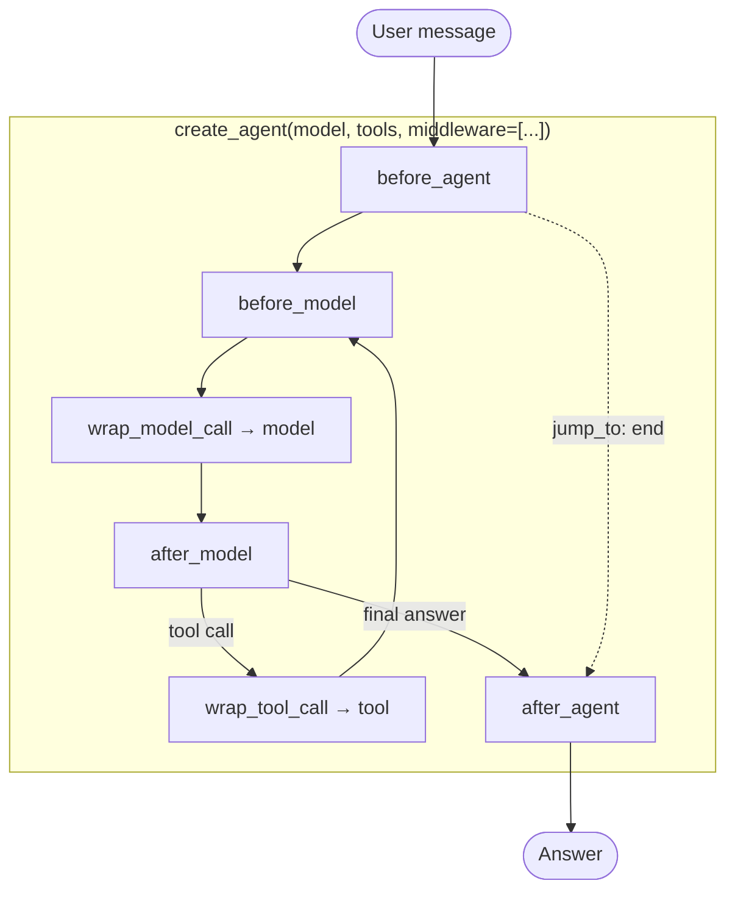

# Agent Middleware, with LangChain

Code for this lesson lives on the [`project/agent-middleware`](https://github.com/emarco177/langchain-course/tree/project/agent-middleware) branch.

One support-desk agent and four kinds of middleware. Middleware plugs into the agent loop at fixed hook points, so you
can observe the loop, guard it, pause it, or steer it without touching the model or the tools.

> **Agent = Model + Harness.** Middleware is how you add your own code to the harness.



## Three jobs for a hook

| Job         | What the hook does                                    | Step   |
| ----------- | ----------------------------------------------------- | ------ |
| **Observe** | Reads the loop and changes nothing (logs, timing, traces) | 02     |
| **Guard**   | Stops or rewrites what passes through (`jump_to`, PII, limits, approval) | 03, 04 |
| **Steer**   | Rewrites the model request (prompt, model, tools)     | 05     |

Order is an onion. For `middleware=[a, b]`, `before_*` hooks run a then b, `after_*` hooks run b then a, and `wrap_*` hooks
nest with `a` outermost. Node hooks (`before_*`, `after_*`) are their own steps in the graph. Wrap hooks run inside the
model or tool step.

## Steps

One commit per step. Check out a commit to see the lesson up to that point.

| #   | Commit    | File                                                         | Look for                                                  |
| --- | --------- | ------------------------------------------------------------ | --------------------------------------------------------- |
| 00  | `1296780` | deps                                                         | Setup only                                                |
| 01  | `4f501b2` | [`01_support_agent.py`](01_support_agent.py)                 | Nobody supervises the $340 refund                         |
| 02  | `083033d` | [`02_tracing_middleware.py`](02_tracing_middleware.py)       | `stopwatch` nests inside `before_model` / `after_model`   |
| 03  | `106d1c9` | [`03_guardrails.py`](03_guardrails.py)                       | `calls: 0` on block, `[REDACTED_EMAIL]`, one refund only  |
| 04  | `1c78a8e` | [`04_human_in_the_loop.py`](04_human_in_the_loop.py)         | `refunds: {}` while paused, then 340, 100 or nothing      |
| 05  | `b279e69` | [`05_runtime_context.py`](05_runtime_context.py)             | Same question: free escalates on luna, pro refunds on sol |

[`desk.py`](desk.py) holds the fake orders and the three tools, so each step only shows its middleware.

## Tracing

With `LANGSMITH_TRACING=true`, 02 prints a trace link. Every hook is its own span, named
`<middleware>.<hook>`: `TimelineMiddleware.before_model`, `stopwatch.wrap_model_call`, and so on.

`trace_policy = TracePolicy(process_inputs=omit_payload)` keeps state off that middleware's own spans. It is **not**
redaction: the model and tool spans still hold the full messages. Use 03's `PIIMiddleware` to keep data from the model,
and LangSmith's `hide_inputs` / anonymizers to keep it out of traces.

## Quick start

```bash
git checkout project/agent-middleware
uv sync
cp .env.example .env   # set OPENAI_API_KEY, and LangSmith for 02's trace link
uv run python 01_support_agent.py
```

Verified against `langchain 1.4.6` and `langgraph 1.2.16`.

## Further reading

- [Middleware overview](https://docs.langchain.com/oss/python/langchain/middleware/overview)
- [Custom middleware](https://docs.langchain.com/oss/python/langchain/middleware/custom)
- [Built-in middleware](https://docs.langchain.com/oss/python/langchain/middleware/built-in)
- [Guardrails](https://docs.langchain.com/oss/python/langchain/guardrails)
- [Human-in-the-loop](https://docs.langchain.com/oss/python/langchain/human-in-the-loop)
- [Runtime](https://docs.langchain.com/oss/python/langchain/runtime) and [context engineering](https://docs.langchain.com/oss/python/langchain/context-engineering)
- [Observability](https://docs.langchain.com/oss/python/langchain/observability)
