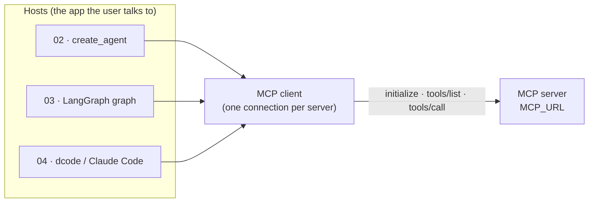

# Model Context Protocol (MCP), with LangChain

Code for this section lives on the [`project/mcp`](https://github.com/emarco177/langchain-course/tree/project/mcp) branch.

One MCP server, three hosts. The server never changes. You swap the host around it and watch the same tools show up
in a LangChain agent, in a LangGraph graph and in a coding agent.



| Word       | What it is                                             | In this section                                   |
| ---------- | ------------------------------------------------------ | ------------------------------------------------- |
| **Server** | Exposes tools over the protocol                        | LangChain's hosted docs server, or your own in 05 |
| **Client** | Holds the connection to one server and speaks protocol | `fastmcp.Client` in 01, `MCPAdapter` in 02 and 03 |
| **Host**   | The app that owns the model and decides what to call   | Your agent in 02 and 03, the coding agent in 04   |

## Steps

One commit per step. Check out a commit to see the lesson up to that point.

| #   | File                                       | Look for                                                         | Key? |
| --- | ------------------------------------------ | ---------------------------------------------------------------- | ---- |
| 00  | deps, [`settings.py`](settings.py)         | The one place a URL or model name is written                     | no   |
| 01  | [`01_client.py`](01_client.py)             | The three calls every client makes. No model involved            | no   |
| 02  | [`02_create_agent.py`](02_create_agent.py) | MCP tools go straight into `create_agent`                        | yes  |
| 03  | [`03_langgraph.py`](03_langgraph.py)       | Same tools, your own graph. Only the host changed                | yes  |
| 04  | [`.mcp.json`](.mcp.json)                   | A coding agent is just another host. Run `/mcp` inside it        | \*   |
| 05  | [`05_docs_server.py`](05_docs_server.py)   | Your own server. Point `MCP_URL` at it and rerun 01 to 04        | no   |

\* whatever your coding agent needs.

## Quick start

```bash
git checkout project/mcp
uv sync
cp .env.example .env   # set OPENAI_API_KEY
uv run python check.py # is the server up? no key needed
uv run python 01_client.py
```

### 01 with the MCP Inspector

```bash
npx @modelcontextprotocol/inspector
```

Pick the **Streamable HTTP** transport, paste the URL that `check.py` printed, connect, open **Tools**, list them and
call one. `01_client.py` makes the same three calls in code.

### 04 with a coding agent

[`.mcp.json`](.mcp.json) is read by both Deep Agents Code (`dcode`) and Claude Code when you start them in this folder.

```bash
dcode        # approve the project server when asked, then type /mcp
```

Ask it: _"Using the docs-langchain tools, how do I add short-term memory to an agent?"_

### 05, your own server

```bash
uv run python 05_docs_server.py              # terminal 1, serves http://localhost:8000/mcp
MCP_URL=http://localhost:8000/mcp uv run python 01_client.py   # terminal 2
```

Set `MCP_URL` in `.env` instead and every lesson, including `.mcp.json`, uses your server.

## If something stopped working

Nothing in the lessons hardcodes a URL, a tool name or a model. They all read [`settings.py`](settings.py), so a fix
is one line in `.env`.

| What happened                           | Fix                                                                                    |
| --------------------------------------- | -------------------------------------------------------------------------------------- |
| `check.py` prints `FAIL`                | Run `05_docs_server.py` and set `MCP_URL=http://localhost:8000/mcp`                    |
| The hosted server moved to a new URL    | Set `MCP_URL` to the new one                                                           |
| The hosted server renamed its tools     | Nothing. The lessons list tools at runtime and never name them                         |
| The model in the video was retired      | Set `MODEL` to any current one, e.g. `MODEL=openai:<name>` or another provider         |
| The docs index (`llms.txt`) moved       | Set `LLMS_TXT_URL`                                                                     |
| An import fails after you upgraded      | `git checkout uv.lock && uv sync` to get back the versions the lessons were tested on  |

Verified against `langchain 1.5.0`, `langgraph 1.2.22`, `fastmcp 4.2.0` and `mcp 2.3.0`. `uv.lock` pins them.

`langchain.mcp` is in beta, so its API may still change. The lock file is what keeps these lessons running if it does.

## Further reading

- [MCP in LangChain](https://docs.langchain.com/oss/python/langchain/mcp)
- [Use the LangChain docs from your AI tools](https://docs.langchain.com/use-these-docs)
- [MCP tools in Deep Agents Code](https://docs.langchain.com/oss/deepagents/code/mcp-tools)
- [Model Context Protocol](https://modelcontextprotocol.io)
