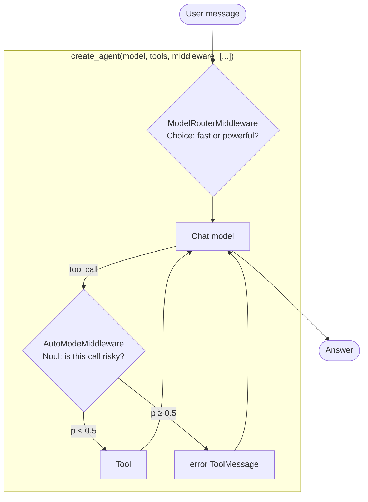

# System One Models, with Jev and LangChain

**Jev** (by [TypeSafe AI](https://typesafe.ai)) never generates text. You give it state and typed
questions, and it returns calibrated answers (a probability, a label, or a score) in milliseconds.

> **Agent = Model + Harness.** The chat model does the work. Jev makes the harness's decisions.



## The three primitives

| Primitive | Question         | You get back                                   |
| --------- | ---------------- | ---------------------------------------------- |
| `Noul`    | yes / no         | `noul`: P(yes)                                 |
| `Choice`  | one of N labels  | `choice`, `probabilities`, `confidence`        |
| `Score`   | ordered rubric   | `score`, `legend`, `probabilities`, `confidence` |

`confidence` describes the shape of the distribution. It is **not** the top label's probability.

## Steps

One commit per step. Check out a commit to see the lesson up to that point.

| #   | Commit    | File                                                             | Look for                                              |
| --- | --------- | ---------------------------------------------------------------- | ----------------------------------------------------- |
| 00  | `HASH0` | `models.py`, deps                                                | Setup only                                            |
| 01  | `HASH1` | [`01_hello_jev.py`](01_hello_jev.py)                             | Managed Jev or local `tev1`: same class, same answer  |
| 02  | `HASH2` | [`02_three_primitives.py`](02_three_primitives.py)               | Three answers from one call                           |
| 03  | `HASH3` | [`03_confidence_gating.py`](03_confidence_gating.py)             | `.batch()` three tickets → auto-route, ask, escalate  |
| 04  | `HASH4` | [`04_messages_and_state.py`](04_messages_and_state.py)           | Messages and a policy inside JSON state               |
| 05  | `HASH5` | [`05_model_router_middleware.py`](05_model_router_middleware.py) | Easy task → `gpt-6-luna`, hard task → `gpt-6-sol`     |
| 06  | `HASH6` | [`06_auto_mode_middleware.py`](06_auto_mode_middleware.py)       | Your delete runs; an injected delete is **BLOCKED**   |

## Quick start

```bash
git checkout project/system-one-models
uv sync
cp .env.example .env   # set TYPESAFE_API_KEY, and OPENAI_API_KEY for 05–06
ollama pull tev1       # open-source Jev for 01 and 03
uv run python 01_hello_jev.py
```

Verified against `langchain-typesafe 0.0.1a3`. The middleware is experimental, so the API may change.

## Running Jev locally

Ollama (0.35+) serves the same Jev API at `/v1/systemone`, so the swap is `base_url` and `model`:

```python
TypeSafeClassifier(base_url="http://localhost:11434", model="tev1", api_key="ollama")
```

`api_key` can be any non-empty string. 05 and 06 stay on managed Jev: the middleware builds its own classifier.

## Coming: OpenAI Decisions API

OpenAI announced a Decisions API (GPT-6 Luna) at DevDay 2026. It is in limited preview with no public schema
or SDK yet, so there is no lesson for it.

## Further reading

- [What Is Jev?](https://www.langchain.com/blog/building-a-harness-with-jev) (LangChain blog)
- [TypeSafe docs](https://docs.typesafe.ai/)
- [LangChain TypeSafe integration](https://docs.langchain.com/oss/python/integrations/providers/typesafe)
