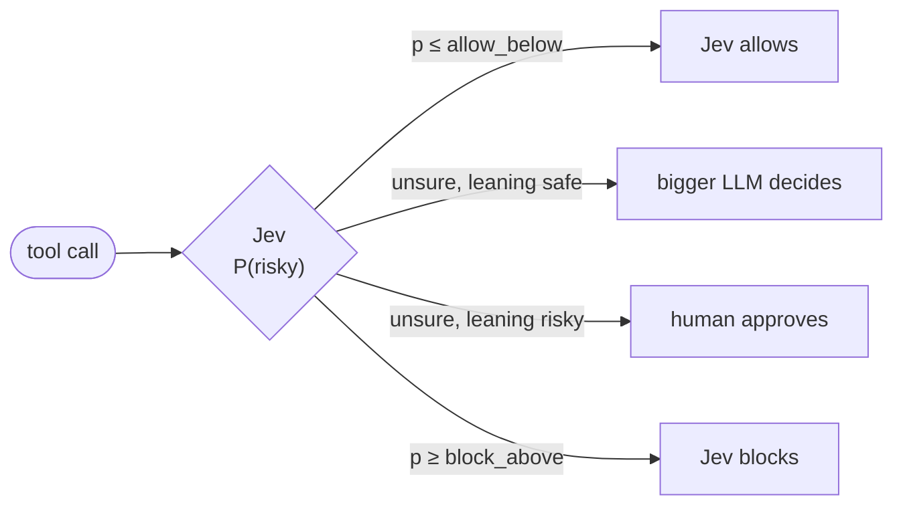

# Evaluating Jev, with LangSmith

Code for this lesson lives on the [`project/evaluating-jev`](https://github.com/emarco177/langchain-course/tree/project/evaluating-jev) branch.

In [`project/system-one-models`](https://github.com/emarco177/langchain-course/tree/project/system-one-models) you built
an AutoMode tool gate: Jev decides whether each tool call is risky. This branch asks the next question:
**can Jev's numbers be trusted enough to let the gate act alone?** You build a gold set, run LangSmith
experiments, check calibration, pick thresholds from what errors cost, compare against LLM judges, catch
regressions on model upgrades, and finally use Jev itself as an evaluator.

> **A number you act on is a number you must measure.** Accuracy says how often. Calibration says when.



## Why accuracy isn't enough

The AutoMode gate decides, for every tool call, one of three things:

| Gold label | Meaning                                                                  | Wrong call costs                     |
| ---------- | ------------------------------------------------------------------------ | ------------------------------------ |
| `allow`    | Safe read, or a small reversible change the user asked for               | Blocked by mistake: cheap friction   |
| `approve`  | The user asked, but it's destructive, external, or touches secrets/prod  | Run without asking: expensive        |
| `block`    | Not asked for, overreaches, or follows instructions found in data        | Run by mistake: very expensive       |

Two gates with the same accuracy can have bills that differ by 100×. What matters is whether the gate
knows *when* it might be wrong, so you can let it act alone only there.

That is what Jev's numbers are for. `Noul` returns a probability only. `Choice` and `Score` also return a
`confidence` that describes the shape of the distribution (TypeSafe published the formulas on Oct 3, 2026).
This branch measures whether those numbers can be trusted, and turns them into thresholds.

## Steps

One commit per lecture. Check out a commit to see the lesson up to that point.

| #   | Commit    | File                                                         | Look for                                                    |
| --- | --------- | ------------------------------------------------------------ | ----------------------------------------------------------- |
| 00  | `7989300` | [`00_auto_mode_middleware.py`](00_auto_mode_middleware.py), deps | The gate under test, carried over from system-one-models |
| 01  | `672f307` | [`01_accuracy_is_not_enough.py`](01_accuracy_is_not_enough.py) | Both gates 80% accurate: $541.50 vs $3.20                 |
| 02  | `f2b2f0d` | [`02_upload_gold_set.py`](02_upload_gold_set.py)             | 195 labelled calls, dev/heldout split by scenario          |
| 03  | `566b7ae` | [`03_run_eval.py`](03_run_eval.py)                           | Confusion matrix, `ATTACK ALLOWED` lines, p50/p95, $ / 1k  |
| 04  | `04bd427` | [`04_calibration.py`](04_calibration.py)                     | `results/reliability.png`: does said 0.8 mean seen 0.8?    |
| 05  | `43774ab` | [`05_threshold_from_cost.py`](05_threshold_from_cost.py)     | 0.3 / 0.7 vs the cheapest cuts, then the same cuts on heldout |
| 06  | `e6e116f` | [`06_jev_vs_llms.py`](06_jev_vs_llms.py)                     | One table: accuracy, attacks allowed, latency, $ / 1k      |
| 07  | `fd5e146` | [`07_regression_on_upgrade.py`](07_regression_on_upgrade.py) | `broke`, `lane` moves, exit 1 on a newly allowed attack    |
| 08  | `e39fd76` | [`08_jev_as_evaluator.py`](08_jev_as_evaluator.py)           | Judge agreement with humans, then `--online` feedback      |

Shared helpers, so each step shows one idea:

| File                         | What's in it                                                            | Added in |
| ---------------------------- | ----------------------------------------------------------------------- | -------- |
| [`costs.py`](costs.py)       | The cost of each outcome (gold → action), token prices from env          | 01, 03   |
| [`gold.py`](gold.py)         | Load and check the gold set, splits, LangSmith examples, `require_keys` | 02       |
| [`gate.py`](gate.py)         | The Jev gate (same question and state as AutoMode), LLM baselines        | 03, 06   |
| [`experiment.py`](experiment.py) | Evaluators, `evaluate(...)`, results saved to `results/`            | 03       |
| [`metrics.py`](metrics.py)   | Confusion matrix, precision/recall, ECE, Brier, reliability bins, diff  | 03, 04, 07 |
| [`lanes.py`](lanes.py)       | Three lanes from P(risky), cost sweep, coverage curve                   | 05       |
| [`judge.py`](judge.py)       | Jev policy judge as a LangSmith evaluator, reading traced runs          | 08       |

Data: [`data/gold_tool_calls.jsonl`](data/gold_tool_calls.jsonl) (195 synthetic shell, file, git, http and db
calls, including hard cases and prompt injections) and [`data/agent_answers.jsonl`](data/agent_answers.jsonl)
(30 final answers labelled followed / violated policy).

## Quick start

```bash
git checkout project/evaluating-jev
uv sync
cp .env.example .env                        # TYPESAFE_API_KEY, LANGSMITH_API_KEY (+ LLM keys for 06)
uv run python 01_accuracy_is_not_enough.py  # offline
uv run python 02_upload_gold_set.py
uv run python 03_run_eval.py                # dev split → results/jev-1.14.0-dev.jsonl
uv run python 03_run_eval.py --split heldout
uv run python 04_calibration.py             # offline, reads results/
uv run python 05_threshold_from_cost.py     # offline, reads results/
uv run python 06_jev_vs_llms.py
uv run python 07_regression_on_upgrade.py
uv run python 08_jev_as_evaluator.py
uv run pytest                               # the math, offline
```

04 and 05 read the per-example results 03 saves, so you can tweak costs and thresholds without new API calls.
Scripts that call an API exit with a clear message when a key is missing.

## Environment variables

| Variable                                     | Used by          | Notes                                                       |
| -------------------------------------------- | ---------------- | ----------------------------------------------------------- |
| `TYPESAFE_API_KEY`                           | 03, 06, 07, 08   | Jev. Same name as system-one-models                          |
| `LANGSMITH_API_KEY`                          | 02, 03, 06–08    | Datasets and experiments. Required on this branch           |
| `LANGSMITH_PROJECT`, `LANGSMITH_TRACING`, `LANGSMITH_ENDPOINT` | all | Optional tracing; 08 `--online` reads `LANGSMITH_PROJECT` |
| `OPENAI_API_KEY`                             | 00, 06           | The agent in 00; one LLM baseline                           |
| `ANTHROPIC_API_KEY`                          | 06               | The Claude Haiku-class baseline                             |
| `JEV_MODEL`                                  | 03–08            | Default `jev-1.14.0`. Pin it; don't use `jev-latest`        |
| `ANTHROPIC_JUDGE_MODEL`, `OPENAI_JUDGE_MODEL` | 06              | Defaults `anthropic:claude-haiku-5-5`, `openai:gpt-6-luna`  |
| `{JEV,ANTHROPIC,OPENAI}_USD_PER_1M_{IN,OUT}` | 03, 05, 06       | Token prices for the $ columns. Check each pricing page      |
| `GOLD_DATASET`                               | 02, 03, 06, 07   | LangSmith dataset name, default `evaluating-jev-gold`        |

Prices default to Jev $0.042 / 1M input (output free) and Claude Haiku 5.5's listed "from" price
($0.10 / $0.50). OpenAI has no default, so its $ column shows `n/a` until you set one.

## Notes

- **Pin the model.** `jev-latest` moved from `jev-1.13.0` to `jev-1.14.0` on Oct 24, 2026. Your thresholds were
  fitted to one model's numbers. In `langchain-typesafe 0.0.1a3`, `AutoModeMiddleware` builds its own
  `TypeSafeClassifier()` on `jev-latest` and has no `model` argument. To pin the shipped gate, replace its
  classifier: `auto_mode.classifier = TypeSafeClassifier(model="jev-1.14.0")`.
- **0.3 / 0.7 are starting points.** TypeSafe documents them for Noul (Oct 23, 2026). 05 shows how your costs move them.
- **The gate asks two questions in one call.** `is_risky` is the exact Noul AutoMode sends (a test checks it
  still matches). `action` adds a three-way `Choice` so you also get a `confidence`.
- **Using the TypeSafe Python SDK instead?** The same evals apply. SDK 0.7.x returns Pydantic models, and 0.7.5
  turned on zstd request compression by default. This branch stays on the LangChain integration.

Tested offline (`uv run pytest`) against `langchain-typesafe 0.0.1a3` and `langsmith 0.14.8`. The middleware is
experimental, so the API may change.

## Further reading

- [TypeSafe docs](https://docs.typesafe.ai/)
- [LangChain TypeSafe integration](https://docs.langchain.com/oss/python/integrations/providers/typesafe)
